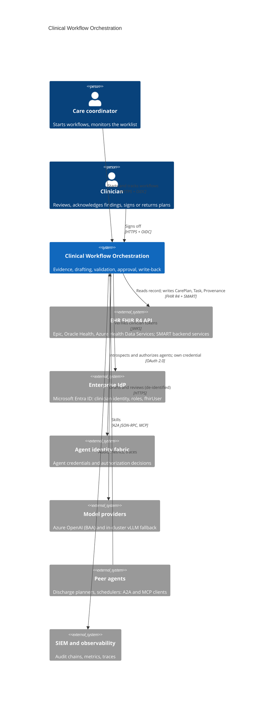
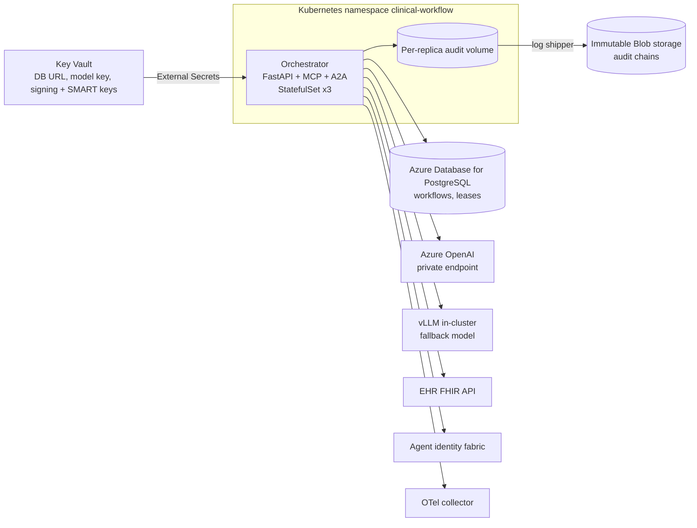
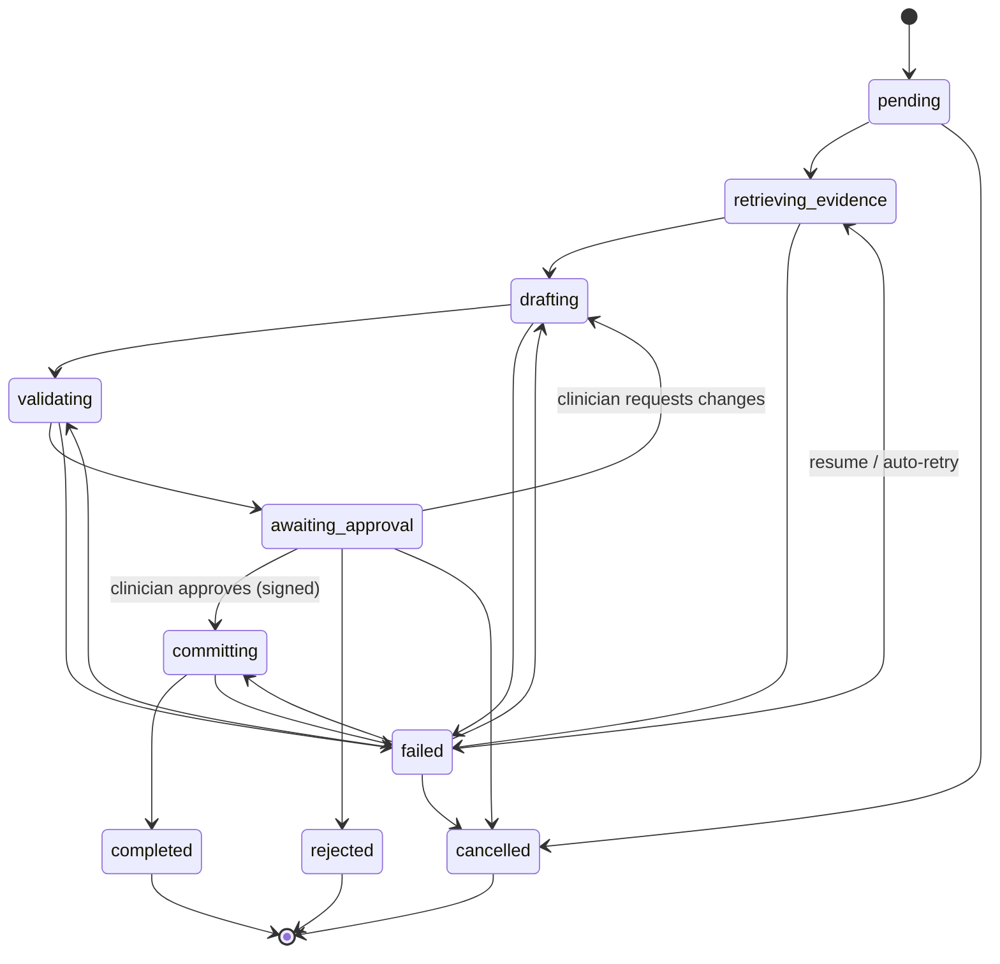
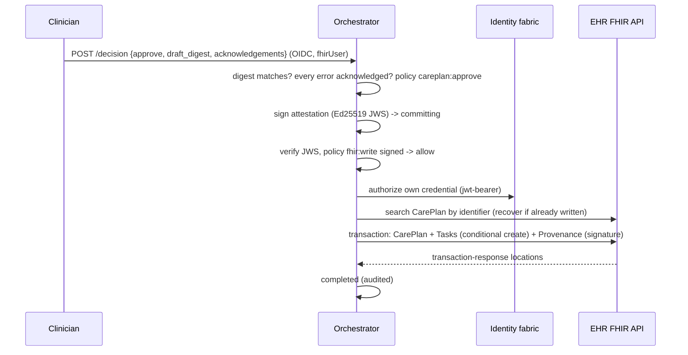
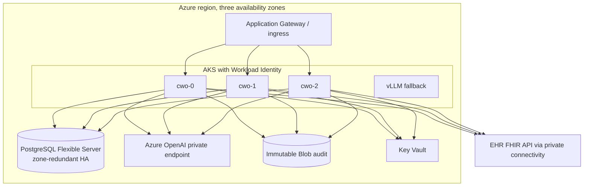

# Architecture

## Business problem

After an inpatient stay, the care plan is where transitions go wrong: follow-up
visits that are never booked, an abnormal potassium nobody rechecks, a new
antibiotic that collides with a documented penicillin allergy, two drugs from
the same class continued side by side. Care coordinators assemble these plans by
hand from the chart, under time pressure, for every discharge.

Language models can draft such plans quickly, but a drafted plan is only useful
if it is grounded in the patient's record, checked by rules that do not
hallucinate, reviewed by a clinician who is accountable for it, and written to
the EHR with a record of who decided what. This service implements that
workflow:

```
Encounter -> Evidence Retrieval -> Care Coordination Agent -> Clinical Validation Agent
          -> Approval Workflow (policy) -> Clinician Sign-off -> EHR write-back + Provenance
```

Nothing is written to the patient record until a clinician signs. Every step is
persisted, resumable, policy-governed and recorded in a signed audit chain.

## System context (C4 level 1)



## Containers (C4 level 2)



## Components (C4 level 3)

| Layer | Module | Responsibility |
|---|---|---|
| API | `api.app`, `api.routes`, `api.schemas` | REST contract for people, OAuth-style errors, correlation IDs, metrics, A2A endpoint, MCP mount |
| Interop | `interop.skills`, `interop.a2a`, `interop.mcp_server` | One authorized, audited skill router behind A2A JSON-RPC, MCP tools and the Agent Framework adapter |
| Orchestration | `orchestration.engine`, `.service`, `.runner`, `.commit` | Persisted state machine, leases, retries, use cases, crash recovery, idempotent EHR commit |
| Agents | `agents.care_coordination`, `agents.clinical_validation`, `agents.llm` | Drafting and review through the guarded, schema-validated model client |
| Clinical | `clinical.evidence`, `clinical.rules`, `clinical.terminology` | FHIR evidence packet with provenance digests; deterministic safety rules; versioned knowledge tables |
| FHIR | `fhir.client`, `fhir.smart`, `fhir.builders`, `fhir.resources` | R4 REST client with paging and retries, SMART backend services, transaction and Provenance builder |
| Governance | `governance.approval` | Policy decisions for people, sign-off and EHR writes (agentic-core PolicyEngine) |
| Security | `security.users`, `security.agents`, `security.jwks`, `security.signing` | Clinician OIDC, agent authorization (fabric or local), JWKS, Ed25519 platform key |
| Integrations | `integrations.identity_fabric`, `integrations.agent_framework` | Identity fabric client and own credential; Microsoft Agent Framework adapter |
| Infrastructure | `infrastructure.database` | SQLAlchemy Core repository with optimistic concurrency and leases |
| Runtime | `runtime.container` | Composition root built from settings |

Shared controls come from [agentic-core](https://github.com/kogunlowo123/agentic-core):
ModelRouter (failover, circuit breakers), ContentGuard (prompt injection,
secrets, PII), PolicyEngine, AuditLog (hash chain, Ed25519 signatures),
structured logging and OpenTelemetry.

## Workflow state machine



Every step's output and its state transition are saved in one optimistic
update (`version` column); a replica must hold the workflow's lease to advance
it, and leases expire so a crashed replica's work is recovered by the sweep.

## Sequences

### Drafting and validation

```mermaid
sequenceDiagram
  participant C as Care coordinator
  participant O as Orchestrator
  participant F as EHR FHIR API
  participant M as Model router
  C->>O: POST /v1/workflows {encounter_id} (OIDC, Idempotency-Key)
  O->>O: policy workflow:start; persist pending; audit
  O-->>C: 202 + workflow id
  O->>F: SMART token (signed client assertion)
  O->>F: Encounter, Patient, Conditions, MedicationRequests, Observations, AllergyIntolerance, CarePlans, Tasks (paged)
  O->>O: evidence packet + provenance digests (de-identified view)
  O->>M: draft (RESTRICTED, guarded, schema-validated)
  M-->>O: CarePlanProposal
  O->>O: deterministic checks: grounding, duplicates, interactions, allergies, follow-up, labs, renal
  O->>M: clinical review (advisory, capped at warning)
  O->>O: policy fhir:write unsigned -> require_approval
  O->>O: state awaiting_approval (audited)
```

### Sign-off and write-back



## Deployment view (Azure reference)



## Data

| Store | Data | Classification | Retention |
|---|---|---|---|
| PostgreSQL `workflows` | Workflow state, evidence packet, draft, validation, sign-off | RESTRICTED (PHI) | Per records policy; at least 6 years for decisions (HIPAA documentation) |
| Audit chains | Who did what, under which policy, with digests | CONFIDENTIAL | 7 years, immutable storage |
| EHR | CarePlan, Task, Provenance written after sign-off | RESTRICTED | EHR record retention |
| Model providers | De-identified evidence and drafts in transit | RESTRICTED | Not retained by design: the deployment requirement is a BAA-covered Azure OpenAI resource approved for modified abuse monitoring (no prompt storage), or the in-cluster model |

Names, addresses, contact details, birth dates and patient ids are never sent
to a model. Access tokens are never persisted or logged.

## Observability

- Prometheus metrics on `/metrics` (own registry): request latency, workflow
  transitions, step durations and failures by code, validation findings,
  clinician decisions, policy decisions, inbound agent decisions, FHIR outcomes,
  model attempts, tokens and spend. Alert rules: `configs/prometheus/alerts.yaml`;
  dashboard: `configs/grafana/clinical-workflow-orchestration.json`.
- OpenTelemetry traces (FastAPI instrumentation, GenAI semantic conventions for
  model calls) exported over OTLP; the collector drops `Authorization` headers.
- JSON logs with correlation IDs (`X-Correlation-ID`), carried into audit events.

## CI/CD

`ci.yml` on every push and pull request: ruff, black, mypy `--strict`, bandit,
contract drift check, all test suites with a 90% coverage gate on Python 3.12
and 3.13; PostgreSQL integration tests; Helm lint, required-values check,
kubeconform; Terraform fmt/validate for AWS, Azure and GCP; Trivy IaC scan;
image build, container smoke test (A2A card, MCP tools, JWKS, auth), Trivy image
scan, Syft SBOM, Grype gate; Semgrep. `release.yml` on a `v*.*.*` tag repeats the
quality gate, pushes the image to GHCR with SBOM and provenance attestation,
pushes the Helm chart to GHCR OCI and creates the GitHub release.

## Cost and scalability

Cost is dominated by model tokens: two calls per workflow revision (draft and
review), roughly 2–4k input and 0.5–1k output tokens each with the synthetic
record. Spend is measured per call from configured contract prices
(`cwo_model_cost_usd_total`) and alerted on. The orchestrator itself is light:
platform overhead per workflow is budgeted at under one second
(`tests/performance`), dominated by persistence and audit signing. Replicas
scale horizontally (HPA on CPU) because all workflow state is in PostgreSQL and
leases arbitrate execution; the runner bounds concurrent workflow steps per
replica so model and EHR rate limits are respected. The EHR's FHIR rate limit
is usually the binding constraint; retries back off exponentially.

## Acceptance criteria

1. No CarePlan, Task or Provenance reaches the EHR without an approving
   clinician sign-off whose signature covers the exact draft (tests:
   `tests/security`, `tests/unit/test_domain_and_persistence.py`).
2. Every error-level validation finding is acknowledged with a reason before
   approval succeeds (policy rule and tests).
3. A workflow interrupted at any step resumes from that step without duplicate
   EHR writes (chaos tests).
4. Model traffic contains no direct identifiers (security test T2).
5. All endpoints, MCP tools and A2A skills enforce authentication and policy;
   generated inputs never produce a 5xx (property-based contract test).
6. CI is green on every job and the release publishes image, chart and SBOM.
